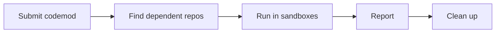

# codemod-eval

A codemod promises to migrate your code to a new version of a library. codemod-eval checks whether it
keeps that promise on real code. It takes public repos that depend on the library and gives each one a
locked-down sandbox. An AI agent gets the repo building and its checks passing there, runs the codemod,
then runs the same checks again.

The result is one verdict per repo and a report per codemod version. Library authors find out how their
codemod does in the wild before their users do, and teams can see whether a codemod is safe to run on
their own code.

## Pipeline



1. **Submit.** You give the codemod (name, version, where it comes from) and what it migrates: a package,
   the version range it migrates from and the version it migrates to. This queues a job.
2. **Find dependent repos.** [ecosyste.ms](https://repos.ecosyste.ms) lists public repos that depend on
   the package. It keeps 5 that use the package directly, are not archived or forks, and are on a version
   in the "from" range. Repos that can't be cloned (deleted or private) are skipped.
3. **Run in sandboxes.** Each repo gets its own [OpenShell](https://github.com/NVIDIA/OpenShell) sandbox.
   An AI agent works in it:
   1. installs the runtime and dependencies the repo needs;
   2. runs the repo's own checks (build, type check, tests) to get a baseline;
   3. runs the codemod, and upgrades the package to the target version if the codemod didn't;
   4. runs the same checks again.
4. **Report.** Each repo gets a verdict. The agent's claim is checked against the commands it actually ran.

   | Verdict          | Meaning                                                    |
   |------------------|------------------------------------------------------------|
   | `passed`         | checks passed before and after the codemod                 |
   | `broke_repo`     | checks passed before, fail after                           |
   | `codemod_failed` | the codemod itself errored or didn't finish                |
   | `setup_failed`   | the repo's checks didn't pass even before the codemod      |
   | `inconclusive`   | no trustworthy result (e.g. the agent never ran the codemod) |

   The report is stored and served at `/reports`.
5. **Clean up.** Sandboxes and clones are always deleted, even when an earlier step fails.

A failed job is retried up to 3 times. Progress, including every command the agent runs, streams live
to the web UI.

### Sandbox

The sandbox is what makes running unknown code safe:
- **Network:** read-only HTTPS to a fixed list of hosts ([policy](src/main/resources/openshell/sandbox-policy.yaml)).
  These are package registries, runtime downloads, the codemod registry and a few build assets.
  Nothing can be uploaded or pushed, and the LLM is not reachable from inside.
- **Image:** Ubuntu with build tools ([Dockerfile](src/main/resources/openshell/sandbox.Dockerfile)); the
  agent installs whatever runtime the repo pins.
- **Limits:** 2 CPUs, 4 GiB of memory and 5 GiB of disk per sandbox.

## Requirements

- Java 25
- The [OpenShell](https://github.com/NVIDIA/OpenShell) CLI, with a gateway running. On macOS, set
  `compute_driver = "vm"` (MicroVM) in the gateway config, because Docker Desktop has no Landlock. It
  also needs `brew install e2fsprogs`.
- Docker, to build the sandbox image.
- An [OpenRouter](https://openrouter.ai) API key.

## Running

```sh
docker build -t codemod-eval-sandbox:1 -f src/main/resources/openshell/sandbox.Dockerfile .

export OPENROUTER_API_KEY=sk-or-...
export OPENROUTER_MODEL=anthropic/claude-haiku-5.5   # optional, this is the default
./gradlew bootRun
```

| URL                            | What                                       |
|--------------------------------|--------------------------------------------|
| http://localhost:8080/         | Web UI: submit a codemod, watch the log    |
| http://localhost:8080/events   | SSE activity stream                        |
| http://localhost:8080/reports/schema | JSON Schema of a report              |
| http://localhost:8080/health   | Health check                               |
| http://localhost:8000/         | JobRunr dashboard (no auth)                |

The database is H2 in PostgreSQL mode, stored in `./data`.

## API

```sh
curl -X POST localhost:8080/codemods -H 'Content-Type: application/json' -d '{
  "name": "react-19-replace-reactdom-render",
  "version": "0.1.4",
  "source": "registry",
  "migration": { "ecosystem": "npm", "packageName": "react", "from": "<19", "to": "19" }
}'

# an npm codemod package holds many migrations; args picks one
curl -X POST localhost:8080/codemods -H 'Content-Type: application/json' -d '{
  "name": "@ai-sdk/codemod", "version": "4.0.4", "source": "npm", "args": "v7",
  "migration": { "ecosystem": "npm", "packageName": "ai", "from": "^6", "to": "7" }
}'

curl 'localhost:8080/codemods?name=react-19-replace-reactdom-render&version=0.1.4'

# 404 until the job has written its report
curl 'localhost:8080/reports?name=react-19-replace-reactdom-render&version=0.1.4'

# JSON Schema of the report
curl localhost:8080/reports/schema
```

- `source`: `registry`, `npm` or `git`. `git` codemods can't be run yet.
- `args`: which migration inside the package, passed after its name (npm codemods). Leave it out when the
  package is a single migration, as every registry codemod is.
- `migration`: what the codemod migrates.
  - `ecosystem`: `npm`, `pypi`, `maven`, `go` or `cargo`. Only npm repos have been exercised end to end.
  - `packageName`: the package whose dependents are tested.
  - `from`: the version range it migrates from; picks the dependent repos.
  - `to`: the version it migrates to. The agent upgrades the package to it if the codemod doesn't. Leave
    it out when the package itself goes away (renamed or split, as with MCP v2).

## Tests

```sh
./gradlew test
```

The tests mock the network, sandbox and LLM, so they don't need OpenShell or an API key.
